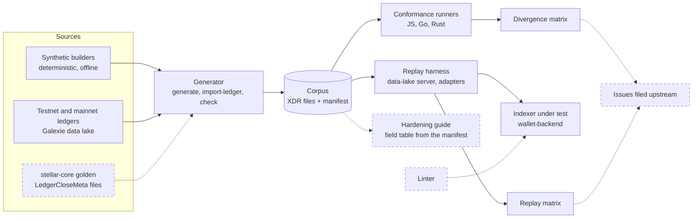

# stellar-xdr-corpus

A shared corpus of rare but valid Stellar ledger data, with a manifest that says what a correct decoder must report for each entry, runners that check the JavaScript, Go and Rust SDKs against it, and a harness that replays its ledgers against an indexer.

**Status: early draft.** Five entries (four synthetic, one real testnet ledger), three SDK runners, a divergence matrix and a replay harness with one indexer adapter (wallet-backend) work today. The linter and the hardening guide are not started. See [Roadmap](#roadmap).

## Why

Every application that reads the Stellar ledger decodes XDR. Rare transaction shapes keep breaking decoders and indexers, and each team finds the same bugs on its own. This repository collects those shapes in one place so a bug found once becomes a test every SDK and indexer can run.

## What the corpus already catches

The corpus reproduces five known bugs on the versions that had them and passes on the versions that fixed them.

### In SDKs

Running the entries through published SDK releases gives the table below. The full results are in [`reports/divergence-matrix.md`](reports/divergence-matrix.md).

| Entry | Bug it reproduces | Fails on | Passes on |
|---|---|---|---|
| `change-trust-pool-issuers-strkey-order-reversed` | [js-stellar-sdk#1766](https://github.com/stellar/js-stellar-sdk/pull/1766): a valid liquidity pool trustline cannot be decoded | 16.3.0, 17.2.0 | 16.4.1, 17.2.1, 17.3.0, 17.4.0 |
| `payment-muxed-ids-beyond-f64`, `manage-offers-ids-beyond-f64` | [js-stellar-sdk#1785](https://github.com/stellar/js-stellar-sdk/issues/1785): builders accept a muxed account ID or offer ID written as `""`, `" 16 "` or `"0x10"` and encode a different ID | 16.3.0, 16.4.1, 17.2.0, 17.2.1 | 17.3.0, 17.4.0 |
| `scval-map-keys-collide-as-native` | [js-stellar-sdk#1789](https://github.com/stellar/js-stellar-sdk/issues/1789): `scValToNative` drops map entries without an error | 16.3.0, 16.4.1, 17.2.0, 17.2.1 | 17.3.0, 17.4.0 |

The go-stellar-sdk and rs-stellar-xdr releases tested pass every entry.

### In an indexer

`testnet-4437357-signed-payload-signer` is testnet ledger 4437357 exactly as stellar-core emitted it. One of its transactions adds a CAP-0040 signed-payload signer. Its expected ledger hash, transaction hash and signer address were checked against Horizon when it was added. Every SDK release tested decodes it correctly. Replaying it against four commits of [stellar/wallet-backend](https://github.com/stellar/wallet-backend) gives the table below. The full results are in [`reports/replay-matrix.md`](reports/replay-matrix.md).

| wallet-backend commit | Result | Bug it reproduces |
|---|---|---|
| `79ea2ac`, before #693 | WRONG VALUE | [wallet-backend#716](https://github.com/stellar/wallet-backend/issues/716): the signer's 40-byte key is cut to 32 bytes when stored, so the row no longer holds the signer the ledger added |
| `2a0a84e`, before #729 | HALT | [wallet-backend#729](https://github.com/stellar/wallet-backend/pull/729): the signer cannot be stored, so ingestion stops at this ledger |
| `2c87335`, #729 merged | pass | |
| `3e22515`, main on 2026-11-12 | pass | |

## How the parts fit

Solid boxes exist today. Dashed boxes are planned. [`docs/ARCHITECTURE.md`](docs/ARCHITECTURE.md) describes each part and the delivery plan in detail.



## Layout

```
corpus/manifest.json      index of entries and their expected values
corpus/entries/*.xdr      one raw binary XDR value per entry
schema/                   JSON Schema for the manifest
generator/                Rust: builds the synthetic entries, imports ledgers, verifies the corpus
runners/js|go|rust/       one conformance runner per SDK
conformance/              runs every SDK release in versions.json, writes the divergence matrix
harness/                  replays corpus ledgers against the indexer commits in indexers.json,
                          writes the replay matrix
harness/adapters/         one adapter per indexer
reports/                  the generated divergence and replay matrices
```

## Manifest

Each entry records:

- `id`, `xdr_type`, `file`, `size`, `sha256`
- `caps` and `protocol`: the CAP that introduced or changed the shape, the protocol version it first appeared in, and the version it was captured under
- `synthetic` and `source`: whether the generator built it or it came from a ledger, and where
- `shapes`: tags for the rare patterns it contains
- `expect`: a named probe and the values a correct decoder must report. 64-bit integers are strings so no JSON parser can round them
- `build` (optional): cases for SDK builders that take untyped input. `accept` lists canonical inputs and what the builder must encode for each. `refuse` lists inputs that are not a canonical value in range, which a builder must reject
- `sightings`: public issues where the shape broke something

The format is defined in [`schema/manifest.schema.json`](schema/manifest.schema.json).

## Run it

Requirements: Rust 1.87 or later, Node 22.15 or later, Go 1.25 or later. The replay also needs Docker and git.

```sh
# Verify the corpus: hashes, sizes, round-trip through rs-stellar-xdr,
# and that the synthetic entries rebuild to identical bytes.
cargo run --release -p corpus-generator -- check

# Run every SDK release in conformance/versions.json and rebuild the divergence matrix.
node conformance/run.mjs

# Replay every corpus ledger against every indexer commit in harness/indexers.json
# and rebuild the replay matrix.
node harness/run.mjs
```

The generator needs no network access, keys or funds. Synthetic entries are built from fixed labels, so two runs give the same bytes. To build the signed entries for mainnet instead of testnet:

```sh
cargo run --release -p corpus-generator -- generate --network pubnet --out /tmp/corpus-pubnet
```

## Entries from real ledgers

Ledgers come from the public Galexie data lake. Download one batch file, decompress it, and import it. The generator itself never uses the network.

```sh
curl -sO https://aws-public-blockchain.s3.us-east-2.amazonaws.com/v1.1/stellar/ledgers/testnet/2025-12-18/FFBC9DFF--4416000-4479999/FFBC4A92--4437357.xdr.zst
zstd -d FFBC4A92--4437357.xdr.zst
cargo run --release -p corpus-generator -- import-ledger --batch FFBC4A92--4437357.xdr --id testnet-4437357-signed-payload-signer
```

`import-ledger` prints the SHA-256 of the extracted ledger. The entry is then described in `generator/src/captured.rs` with that hash and its expected values. On every run the generator checks the committed file against the pinned hash and re-derives the expected values from the bytes.

## How a runner judges an entry

1. Check the file against the manifest's SHA-256.
2. Decode it as `xdr_type` and re-encode it. The bytes must be identical.
3. Apply the entry's probe: read the values the SDK reports through its public API and compare each with the manifest.
4. If the entry has `build` cases and the SDK has a builder for them, feed it each case. An `accept` input must encode exactly the value the manifest gives. A `refuse` input must raise an error.

A returned value that differs is reported as **WRONG VALUE**, and so is a `refuse` input that the builder accepts. An error on valid ledger data is reported as **ERROR**. Where an SDK's native type cannot hold a value, the manifest can list that value under `may_refuse`, and an explicit error then counts as a pass. Returning a different value silently never passes.

Build cases are run by the JavaScript runner only. The Go and Rust builders take typed integers, so the inputs in these cases cannot be written for them.

## How a replay judges an indexer

1. The harness starts a local read-only server that holds each corpus ledger in the layout Galexie writes: a manifest and one zstd-compressed `LedgerCloseMetaBatch` per ledger. The server speaks the part of the S3 API that go-stellar-sdk's datastore client uses, so the indexer reads from it with its normal data-lake settings.
2. The adapter builds the indexer from an unmodified checkout of the listed commit and gives it an empty database. It starts the indexer as an instance whose last ingested ledger is the one before the corpus ledger.
3. If the indexer does not move its cursor past the ledger, the result is **HALT**, and the report quotes the indexer's own error.
4. Otherwise the adapter reads values back from the indexer's database under the same keys the manifest uses. A value that differs is reported as **WRONG VALUE**.

The harness only counts a run in which the indexer fetched the ledger from the server. The RPC and history archive URLs given to the indexer answer every request with an error, so a result never depends on a live Stellar network.

An adapter is one module in `harness/adapters/`. It exports `name`, `repository`, `database` (the Docker image its indexer stores to), `build(commit, context)` and `replay(build, entry, context)`. `replay` returns `{ ingested: false, reason }` or `{ ingested: true, values }`. [`harness/adapters/wallet-backend.mjs`](harness/adapters/wallet-backend.mjs) is the reference.

## Roadmap

- More entries from real testnet and mainnet ledgers, and from stellar-core's golden `LedgerCloseMeta` files
- Per-CAP coverage report
- Replay: a ledger for [wallet-backend#731](https://github.com/stellar/wallet-backend/issues/731), a second way to serve ledgers (a mock RPC `getLedgers` endpoint), and an adapter for stellar-etl
- File the findings upstream, one issue per failure
- Linter for the three common indexer mistakes
- Indexer-hardening guide

## License

Apache-2.0. See [LICENSE](LICENSE).
