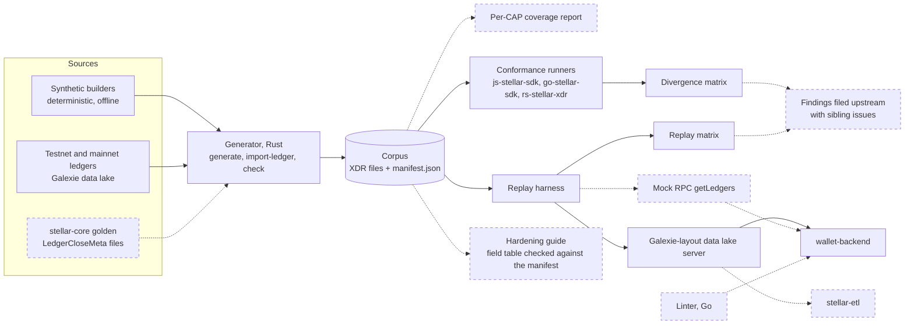

# Technical architecture

This document describes how the Stellar XDR Corpus is built, how it connects to existing Stellar software, and how the remaining work is planned. It is the technical architecture document for the SCF #46 RFP "XDR/CAP-Coverage Audit Tool and Indexer-Hardening Guide".

Parts marked **built** run today in this repository's CI. Parts marked **planned** are the funded work.

## 1. What the project is

A shared test kit for software that reads the Stellar ledger. It has six parts:

| Part | Purpose | State |
|---|---|---|
| Corpus and manifest | Rare but valid ledger data, one entry per pattern, tagged with the CAP that introduced it and the values a correct decoder must report | built, 5 entries |
| Generator | Builds the synthetic entries, imports real ledgers, verifies the corpus | built |
| Conformance runner | Runs the corpus through released JavaScript, Go and Rust SDKs and writes a divergence matrix | built |
| Replay harness | Serves corpus ledgers to an unmodified indexer and reports what it halts on or stores wrongly | built, 1 adapter |
| Linter | Flags the three ingestion mistakes the RFP names, in Go indexer source | planned |
| Indexer-hardening guide | Field-by-field guidance for indexer authors, with a checklist | planned |

The project deploys no smart contract, runs no hosted service and holds no keys or funds. Everything it produces is files in a Git repository and results in CI.

## 2. System diagram

Solid boxes are built. Dashed boxes are planned.

## 3. How it integrates with Stellar

Every component reads or produces Stellar XDR and is checked against released Stellar software.

### 3.1 Corpus and manifest

- **Format.** Each entry is one raw binary XDR value (`TransactionEnvelope`, `ScVal` or `LedgerCloseMeta` so far) in `corpus/entries/`. `corpus/manifest.json` describes every entry and is validated in CI against `schema/manifest.schema.json` (JSON Schema 2020-12). The format is language-neutral: any pipeline that can read a file and parse JSON can use it.
- **What the manifest records.** Entry ID, XDR type, size and SHA-256; the CAP and the protocol version that introduced the shape, and the protocol version it was captured under; whether it is synthetic; its source (for a real ledger: network, sequence and retrieval URL); shape tags; the expected decoded values; optional builder cases; and the public issues where the shape broke something.
- **Expected values.** Each entry names a probe and the values a correct decoder must report through it. 64-bit integers are JSON strings so that no parser can round them. Addresses are SEP-0023 strkeys, including the muxed (`M...`) and signed-payload (`P...`) forms.
- **Synthetic entries.** Built by the generator from fixed labels, so two runs give identical bytes. They are marked `synthetic: true`. Signed entries rebuild to identical bytes for either the testnet or the mainnet network passphrase.
- **Real entries.** Imported from the public Galexie data lake exactly as stellar-core emitted them. The generator pins each one by SHA-256 and re-derives its expected values from the bytes on every run. The first is testnet ledger 4437357, whose expected ledger hash, transaction hash and signer address were checked against Horizon.
- **Planned.** Entries taken from the golden `LedgerCloseMeta` files stellar-core checks with `--check-lcm` ([stellar-core#5435](https://github.com/stellar/stellar-core/pull/5435)), so the corpus agrees with core's own CI data; entries produced by a local stellar-core for shapes that are hard to find in history; and a per-CAP coverage report generated from the manifest, listing each CAP with its entries or the reason it has none.

### 3.2 Generator

A Rust binary built on `stellar-xdr` 30.0.0 and `stellar-strkey` 1.0.0, both pinned exactly. It has three commands:

- `generate` builds the synthetic entries and writes the manifest.
- `import-ledger` extracts one `LedgerCloseMeta` from a Galexie batch file.
- `check` verifies hashes and sizes, round-trips every entry through rs-stellar-xdr, and confirms the synthetic entries rebuild to the committed bytes.

It needs no network access, keys or funds.

### 3.3 Conformance runner

One small runner per SDK decodes each entry, re-encodes it, and reads values through the SDK's public API:

| SDK | Runner | Releases tested today |
|---|---|---|
| js-stellar-sdk (`@stellar/stellar-sdk`) | `runners/js` | 16.3.0, 16.4.1, 17.2.0, 17.2.1, 17.3.0, 17.4.0 |
| go-stellar-sdk | `runners/go` | v0.7.3, v0.8.0, v0.9.0 |
| rs-stellar-xdr | `runners/rust` | 30.0.0 |

`conformance/run.mjs` installs each release listed in `conformance/versions.json`, runs the corpus through it and writes `reports/divergence-matrix.md`. A cell is **pass**, **WRONG VALUE** (the SDK returned a value that differs from the ledger without an error) or **ERROR** (the SDK raised an error on valid ledger data). CI fails if the committed matrix differs from a fresh run.

Entries can also carry `build` cases for SDK builders that take untyped input: inputs a builder must accept, with the exact encoding expected, and inputs it must refuse.

Planned: a documented way for an SDK repository to run the corpus in its own CI from a pinned corpus release, and a scheduled run that tests each new SDK release as it is published.

### 3.4 Replay harness

The harness delivers ledgers through an input that existing pipelines already consume. **The Galexie data lake layout is supported first and is built.** A mock RPC `getLedgers` endpoint is planned as the second input.

1. A local read-only server holds each corpus ledger in the layout Galexie writes: a `.config.json` manifest and one zstd-compressed `LedgerCloseMetaBatch` per ledger, under Galexie's partition and file naming. It speaks the part of the S3 API that go-stellar-sdk's `datastore` client uses.
2. An adapter builds the indexer from an unmodified checkout of a given commit, gives it an empty database, and starts it with its normal data-lake settings pointed at the local server.
3. If the indexer does not move its cursor past the ledger, the result is **HALT** and the report quotes the indexer's own error. Otherwise the adapter reads values back from the indexer's database under the same keys the manifest uses, and a value that differs is **WRONG VALUE**.

The RPC and history archive URLs given to the indexer answer every request with an error, and a run only counts if the indexer fetched the ledger from the local server. A result therefore never depends on a live Stellar network.

**Adapter interface.** An adapter is one module that exports `name`, `repository`, `database`, `build(commit, context)` and `replay(build, entry, context)`. `replay` returns `{ ingested: false, reason }` or `{ ingested: true, values }`. The reference adapter targets [stellar/wallet-backend](https://github.com/stellar/wallet-backend), which stores to TimescaleDB.

Planned: a ledger for [wallet-backend#731](https://github.com/stellar/wallet-backend/issues/731); the mock RPC input; a memory ceiling on the harness with a test that replays the full corpus under it; and a second adapter for [stellar/stellar-etl](https://github.com/stellar/stellar-etl).

### 3.5 Linter (planned)

- **Scope.** Go, for indexers built on go-stellar-sdk's `ingest` package. Both SDF pipelines named in the RFP, wallet-backend and stellar-etl, are Go programs that import it.
- **Form.** Analyzers written with `golang.org/x/tools/go/analysis`, run as a standalone command and through `go vet -vettool`.
- **Rules.** One rule ID per mistake the RFP lists:
  1. trusting a field stellar-core does not validate;
  2. walking a recursive structure, such as an authorization tree or a nested `ScVal`, without a depth or size cap;
  3. deriving a transaction's participants from the envelope instead of the meta.
- **Checks.** A test suite of seeded violations that every rule must flag, and a clean run on current wallet-backend.

### 3.6 Indexer-hardening guide (planned)

Written in Markdown to the RFP's fixed outline, ready to publish on developers.stellar.org:

1. which transaction fields stellar-core validates and which it passes through;
2. recommended depth and size caps;
3. the participants-from-meta rule;
4. handling of muxed and signed-payload addresses, including their SEP-0023 strkey forms;
5. a checklist carrying the linter's three checks for indexers in other languages.

The field-by-field table is generated from, and tested against, the corpus manifest. Publication is gated on review by a core or platform engineer.

## 4. Evidence so far

The corpus reproduces five sightings from the RFP on the versions that had them and passes on the versions that fixed them. Both reports are regenerated in CI on every push to `main` and every pull request, and CI fails if they change.

| Sighting | Result | Where it fails | Where it passes |
|---|---|---|---|
| [js-stellar-sdk#1766](https://github.com/stellar/js-stellar-sdk/pull/1766) | ERROR | 16.3.0, 17.2.0 | 16.4.1, 17.2.1, 17.3.0, 17.4.0 |
| [js-stellar-sdk#1785](https://github.com/stellar/js-stellar-sdk/issues/1785) | WRONG VALUE | 16.3.0, 16.4.1, 17.2.0, 17.2.1 | 17.3.0, 17.4.0 |
| [js-stellar-sdk#1789](https://github.com/stellar/js-stellar-sdk/issues/1789) | WRONG VALUE | 16.3.0, 16.4.1, 17.2.0, 17.2.1 | 17.3.0, 17.4.0 |
| [wallet-backend#716](https://github.com/stellar/wallet-backend/issues/716) | WRONG VALUE | commit `79ea2ac` | commits `2c87335`, `3e22515` |
| [wallet-backend#729](https://github.com/stellar/wallet-backend/pull/729) | HALT | commit `2a0a84e` | commits `2c87335`, `3e22515` |

The go-stellar-sdk and rs-stellar-xdr releases tested pass every entry. Full results: [`reports/divergence-matrix.md`](../reports/divergence-matrix.md) and [`reports/replay-matrix.md`](../reports/replay-matrix.md).

One finding is already filed upstream: [js-stellar-sdk#1898](https://github.com/stellar/js-stellar-sdk/issues/1898), which asks whether the #1789 fix should reach the maintained 16.x line, where 16.4.1 still drops map entries.

Not yet reproduced: [wallet-backend#731](https://github.com/stellar/wallet-backend/issues/731). It needs a ledger in which the Stellar Asset Contract creates a trustline.

## 5. Technology stack

| Component | Language | Main dependencies |
|---|---|---|
| Generator | Rust 1.87+ | `stellar-xdr` 30.0.0, `stellar-strkey` 1.0.0 |
| Rust runner | Rust | `stellar-xdr` 30.0.0 |
| JavaScript runner | Node.js 22.15+ | `@stellar/stellar-sdk`, one install per tested release |
| Go runner | Go 1.25+ | `go-stellar-sdk`, one build per tested release |
| Conformance driver and replay harness | Node.js 22.15+, standard library only | Docker, for the indexer's database |
| Manifest validation | Node.js | Ajv 8.17.1 |
| Linter (planned) | Go | `golang.org/x/tools/go/analysis` |

The corpus is built against the most recent stable Stellar XDR release. The manifest records the crate version and protocol version it was built with (`stellar-xdr` 30.0.0, protocol 30).

## 6. Infrastructure, decentralization and user tracking

- **Infrastructure.** A public GitHub repository and GitHub Actions. There is no server, database or hosted endpoint to operate. The replay harness starts its database as a throwaway local container and removes it afterwards.
- **Decentralization.** There is no service to decentralize. The corpus is plain files under Apache-2.0 that anyone can copy, fork and run offline. Releases will be tagged, and every entry is pinned by SHA-256 in the manifest, so a consumer can verify a copy independently of this repository.
- **User tracking.** None. The tools make no network requests of their own beyond installing the SDK releases and cloning the indexer under test, and they collect no telemetry.

## 7. Threat model and monitoring

The project deploys nothing on-chain, so its security work is about the integrity of the test data and the tools. Tranche 2 delivers a written threat model and monitoring plan covering at least:

| Threat | Mitigation | State |
|---|---|---|
| A corpus entry or its expected values are wrong, so a correct SDK is reported as broken or a broken one passes | The generator re-derives expected values from the bytes on every run; real ledgers are pinned by hash and checked against a second source; a finding is filed upstream only after it is reproduced on a pre-fix version | built |
| A corpus entry is tampered with | SHA-256 per entry in the manifest, verified by the generator and by every runner before decoding | built |
| A dependency is replaced or compromised | Exact version pins and lock files; each SDK release under test is installed in its own directory with install scripts disabled | built |
| The harness executes code from the indexer it tests | Indexers are built from commits pinned by full hash and run with a minimal environment and dummy credentials, against local services only | built |
| The harness exhausts memory on a hostile entry | A memory ceiling tested against the full corpus | planned |
| A corpus finding exposes an unfixed vulnerability | Findings that could halt or corrupt a production pipeline are reported privately through the affected project's security policy before being published | planned |

The monitoring plan covers what the project does run. CI on every push to `main` and every pull request is in place. A scheduled run against newly published SDK releases, and a check for new stellar-xdr releases and protocol versions, are planned.

## 8. Delivery plan

Three tranches, following the SCF structure. The final tranche is the production release, which is this project's equivalent of a mainnet launch. The plan covers new work only: everything marked **built** above was done before the proposal.

### Tranche 1: corpus, coverage and conformance

- Corpus of at least 40 entries covering every shape the RFP names (issuers that sort differently by strkey and by XDR bytes, muxed sources and recipients, muxed account and offer IDs, vectors at maximum length, nested authorization entries, colliding map keys) and the shapes behind its public sightings.
- Generator support for stellar-core golden `LedgerCloseMeta` files and for entries produced by a local stellar-core.
- Per-CAP coverage manifest and report.
- Conformance runner for the JavaScript, Go and Rust SDKs with a probe for every entry, the divergence matrix checked in CI, a scheduled run against newly published SDK releases, and instructions for running the corpus in an SDK repository's own CI.
- Hardening guide: outline and first field-by-field table.

Check: `corpus-generator check` passes; every entry round-trips through rs-stellar-xdr; entries taken from golden files agree with stellar-core's `--check-lcm` goldens; the runner reproduces js-stellar-sdk#1766, #1785 and #1789 on pre-fix tags and passes on fixed ones.

### Tranche 2: replay harness and findings

- Replay harness with the documented adapter interface, the Galexie-layout input and the mock RPC `getLedgers` input, a result for data an indexer silently drops, and a tested memory ceiling.
- Reference adapter for wallet-backend, including a ledger that reproduces wallet-backend#731.
- Findings reports from running the corpus against wallet-backend and the three SDKs, one entry per finding (issue link, corpus entry, severity, affected CAP and component), each filed upstream with sibling issues in the other affected SDKs.
- Hardening guide: complete draft, sent for review by a core or platform engineer.
- Threat model and monitoring plan.

Check: the reference adapter reproduces wallet-backend#729, #731 and #716 on pre-fix commits and passes on the fixed ones; every failure in the reports maps to a filed issue.

### Tranche 3: linter, guide and production release

- Go linter with rule IDs for the three mistakes, and its seeded-violation test suite.
- Hardening guide, reviewed and ready to publish on developers.stellar.org, with the checklist.
- Second adapter, for stellar-etl, with its findings filed.
- Release 1.0: versioned corpus releases, coverage of the current mainnet protocol, tests and CI for all tooling, and user documentation.
- Published maintenance plan.

Check: the linter flags every seeded violation and runs clean on current wallet-backend; the guide's field table agrees with the manifest; release 1.0 is tagged and CI is green.

## 9. Maintenance

The author maintains the repository for 12 months after release 1.0, and at least through the first protocol upgrade after delivery. For each new protocol version: add entries for the CAPs it ships, update the stellar-xdr pin, rerun the matrices against the new SDK releases and file what they find. The project has no hosting cost, so maintenance needs time only.

Status updates are posted publicly at least once a month, in the repository and in the Stellar Developers Discord.

## 10. License

Apache-2.0. All development happens in public in this repository.
